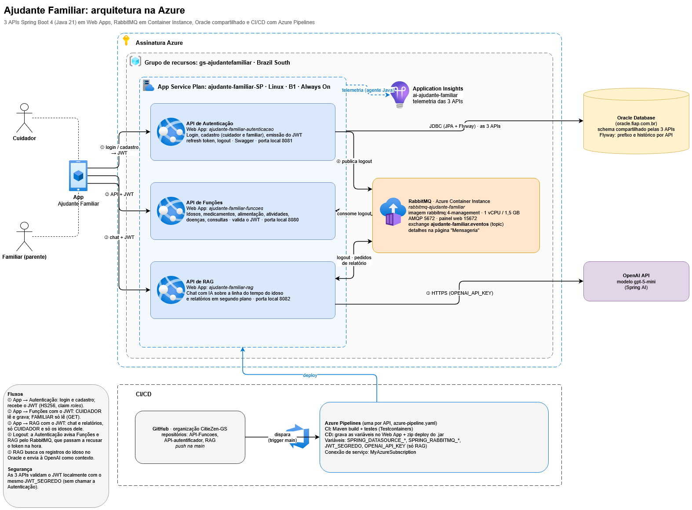
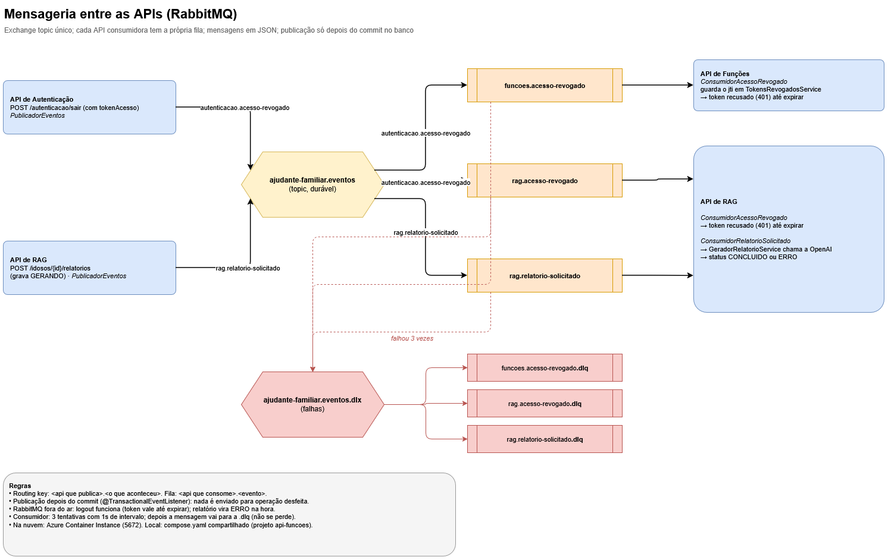

# Ajudante Familiar · API de Autenticação

Serviço de contas e login do **Ajudante Familiar**, a CitizenTech do grupo na Global Solution 2026/2 (FIAP · 2TDS). Cria as contas de cuidadores e familiares, faz o login e emite o **JWT** com o papel do usuário (**CUIDADOR** ou **FAMILIAR**), que as outras APIs usam para liberar ou bloquear cada função do app.

## Integrantes

| Nome | RM |
|---|---|
| Gabriel Fachin de Oliveira | RM561551 |
| Fernando Charlles Faustino Fernandes | RM566482 |
| Iago D. Ainette | RM565708 |
| Leticia Santiago | RM565799 |

## Links

| O quê | Endereço |
|---|---|
| API de autenticação (este repositório) | https://github.com/CitieZen-GS/API-autentificador |
| API de funções (CRUD do idoso) | https://github.com/CitieZen-GS/API-Funcoes |
| API de RAG (IA generativa) | https://github.com/CitieZen-GS/RAG |
| App Mobile | https://github.com/CitieZen-GS/Mobile |
| Deploy desta API (Swagger) | https://ajudante-familiar-autenticacao.azurewebsites.net/swagger-ui.html |

> Endereço de deploy: confira o **Domínio padrão** do Web App no portal da Azure antes da entrega.

## Arquitetura



O sistema tem três microsserviços Spring Boot, cada um em um Azure App Service (Linux, Java 21, mesmo plano B1), um banco Oracle compartilhado, RabbitMQ no Azure Container Instance e Application Insights. A descrição completa da solução está no [README da API de funções](https://github.com/CitieZen-GS/API-Funcoes#readme).

| Serviço | Responsabilidade | Porta local |
|---|---|---|
| API de funções | CRUD do idoso e da rotina de cuidados | 8080 |
| **API de autenticação** (este) | cadastro, login e emissão do JWT | 8081 |
| API de RAG | chat com IA sobre a linha do tempo do idoso e relatórios | 8082 |

### Fluxo de autenticação (JWT)

1. O app envia e-mail e senha para `/autenticacao/login`. A senha é conferida com o hash **BCrypt** guardado no banco.
2. O tipo de usuário vem da tabela onde o e-mail foi encontrado: `T_Ajudante_familiar_Cuidador` gera o papel **CUIDADOR**; `T_Ajudante_familiar_Parente` gera **FAMILIAR**.
3. A API devolve um **token de acesso** (JWT, 60 min) e um **token de atualização** (7 dias, guardado no banco só como hash SHA-256).
4. O app envia o token de acesso nas outras APIs. Elas validam a assinatura **HS256** com o mesmo segredo (`JWT_SEGREDO`) e liberam as rotas pelo papel: CUIDADOR lê e escreve, FAMILIAR só lê.
5. Quando o token de acesso vence, o app troca o token de atualização por um par novo em `/autenticacao/atualizar` (o antigo é revogado).
6. No logout (`/autenticacao/sair`), o token de atualização é revogado e, se o app mandar também o token de acesso, esta API publica o evento `AcessoRevogadoEvento` no RabbitMQ: as APIs de funções e de RAG passam a recusar o token na hora.

Claims do JWT:

| Claim | Cuidador | Familiar |
|---|---|---|
| `sub` | id do cuidador | id do parente |
| `roles` | `["CUIDADOR"]` | `["FAMILIAR"]` |
| `permissoes` | `["LEITURA", "ESCRITA"]` | `["LEITURA"]` |
| `id_idoso` | não existe | idoso que o familiar acompanha |
| `nome`, `email` | dados do usuário | dados do usuário |
| `jti`, `iss`, `iat`, `exp` | id único, `ajudante-familiar-autenticacao`, emissão, expiração | idem |

### Requisito 5 de Java Advanced: opção escolhida

**Opção A: RabbitMQ.** Esta API **publica** o `AcessoRevogadoEvento` (routing key `autenticacao.acesso-revogado`, exchange topic `ajudante-familiar.eventos`) depois do commit do logout. As APIs de funções e de RAG **consomem** o evento de forma assíncrona, cada uma na sua fila, com retentativa e fila de falhas (`.dlq`).



## Tecnologias

- **Java 21**, **Spring Boot 4.1.2**, **Maven** (Maven Wrapper incluído)
- **Spring Security** + **OAuth2 Resource Server** (`NimbusJwtEncoder` / `NimbusJwtDecoder`): emissão e validação do JWT
- **Spring Data JPA** + **Oracle** (`ojdbc17`), **Flyway** (prefixo `M_AUT_V`, histórico `flyway_historico_autenticacao`)
- **Spring AMQP**: publicação de eventos no RabbitMQ
- **Bean Validation** e tratamento global de erros (`@RestControllerAdvice`)
- **springdoc-openapi 3.1.0**: Swagger / OpenAPI
- **Spring Boot Docker Compose**: Oracle e RabbitMQ em desenvolvimento
- Testes: **JUnit 5**, **Testcontainers** (Oracle Free e RabbitMQ)

## Estrutura do repositório

```
autentificador/
├── azure-pipeline.yml          # CI/CD no Azure Pipelines
├── dockerfiles/
│   └── compose.yaml            # Oracle e RabbitMQ para desenvolvimento (igual nas 3 APIs)
├── docs/                       # desenho da arquitetura
├── scripts/
│   ├── azure-infra.sh          # Azure CLI: toda a infraestrutura (igual nos 3 repositórios)
│   ├── sincronizar-infra.sh    # confere ou replica os scripts de infra nos 3 repositórios
│   └── script-bd.sql           # DDL da tabela de tokens e dados padrão de cargos e perfis
├── src/main/java/on/fiap/com/br/autentificador/
│   ├── controller/             # rotas de login e cadastro, tratamento de erros
│   ├── services/               # login, cadastro, emissão de tokens
│   ├── repositories/  models/  dto/
│   ├── mensageria/             # publicação do AcessoRevogadoEvento
│   └── configuracoes/          # segurança (JWT) e OpenAPI
├── src/main/resources/db/migration/   # migrations Flyway
├── src/test/                   # testes automatizados
├── .env.example                # variáveis de ambiente, sem credenciais
└── pom.xml
```

Esta API cria só a tabela `T_Ajudante_familiar_Token_Atualizacao` e os cargos e perfis padrão. Cuidadores, parentes e idosos ficam nas tabelas criadas pela API de funções, no mesmo schema.

## Como rodar localmente

### Pré-requisitos

- **JDK 21** e **Docker Desktop** aberto ("Engine running", modo Linux containers)
- A **API de funções rodando ou já executada uma vez** no mesmo banco: as tabelas de cuidador, parente e idoso são criadas pelas migrations dela.

### Subindo a aplicação

```bash
# Windows (PowerShell)
.\mvnw spring-boot:run

# Linux / macOS
./mvnw spring-boot:run
```

O Spring Boot usa o `dockerfiles/compose.yaml`. Como o arquivo é igual nas 3 APIs (projeto `api-funcoes`), esta API reaproveita o Oracle e o RabbitMQ que a API de funções já subiu.

| Serviço | Endereço |
|---|---|
| API | http://localhost:8081 |
| Swagger UI | http://localhost:8081/swagger-ui.html |
| Oracle / RabbitMQ | ver [API de funções](https://github.com/CitieZen-GS/API-Funcoes#serviços-e-portas) |

### Variáveis de ambiente

Em desenvolvimento nenhuma é obrigatória. Fora do Docker Compose, use o modelo [`.env.example`](.env.example):

| Variável | Descrição |
|---|---|
| `SPRING_DATASOURCE_URL`, `SPRING_DATASOURCE_USERNAME`, `SPRING_DATASOURCE_PASSWORD` | banco Oracle |
| `SPRING_RABBITMQ_HOST`, `SPRING_RABBITMQ_PORT`, `SPRING_RABBITMQ_USERNAME`, `SPRING_RABBITMQ_PASSWORD` | RabbitMQ |
| `JWT_SEGREDO` | segredo HS256, mínimo 32 caracteres, **igual nas 3 APIs** |
| `JWT_EXPIRACAO_ACESSO_MINUTOS` | opcional, validade do token de acesso (padrão 60) |
| `JWT_EXPIRACAO_ATUALIZACAO_DIAS` | opcional, validade do token de atualização (padrão 7) |

## Usuários de teste

Crie este par de usuários uma vez (local ou no deploy) e use-o nos testes:

| Papel | E-mail | Senha |
|---|---|---|
| CUIDADOR | `maria.cuidadora@ajudante.com` | `senha123` |
| FAMILIAR | `ana.familiar@ajudante.com` | `senha123` |

```http
POST /autenticacao/cadastro/cuidador
{ "nome": "Maria", "cpf": "123.456.789-09", "email": "maria.cuidadora@ajudante.com", "senha": "senha123" }
```

A resposta (201) já traz os tokens. Cadastre um idoso na API de funções (`POST /idosos`) com o token da Maria e então crie a familiar:

```http
POST /autenticacao/cadastro/parente
Authorization: Bearer <tokenAcesso da Maria>
{ "nome": "Ana", "telefone": "(11) 98765-4321", "email": "ana.familiar@ajudante.com", "senha": "senha123", "idIdoso": 1 }
```

## Endpoints

| Método | Rota | Acesso | Corpo | Resposta |
|---|---|---|---|---|
| POST | `/autenticacao/cadastro/cuidador` | público | `{"nome", "cpf"?, "email", "senha"}` | 201 + tokens (já sai logado) |
| POST | `/autenticacao/cadastro/parente` | CUIDADOR, só para um idoso dele | `{"nome", "telefone"?, "email", "senha", "idIdoso"}` | 201 + usuário |
| POST | `/autenticacao/login` | público | `{"email", "senha"}` | `tokenAcesso`, `tokenAtualizacao`, `expiraEm` (segundos), `usuario` |
| POST | `/autenticacao/atualizar` | público | `{"tokenAtualizacao"}` | novo par de tokens |
| POST | `/autenticacao/sair` | público | `{"tokenAtualizacao", "tokenAcesso"?}` | 204 |
| GET | `/autenticacao/eu` | CUIDADOR ou FAMILIAR | — | dados do usuário do token |

Exemplo de login:

```http
POST /autenticacao/login
{ "email": "maria.cuidadora@ajudante.com", "senha": "senha123" }
```

```json
{
  "tokenAcesso": "eyJhbGciOiJIUzI1NiJ9...",
  "tipoToken": "Bearer",
  "expiraEm": 3600,
  "tokenAtualizacao": "f3a1c0...",
  "usuario": { "id": 1, "nome": "Maria", "email": "maria.cuidadora@ajudante.com", "tipo": "CUIDADOR", "permissoes": ["LEITURA", "ESCRITA"], "idIdoso": null }
}
```

Regras: e-mail único entre cuidadores e familiares (salvo em minúsculas); CPF salvo como `000.000.000-00`; senha de 6 a 72 caracteres, salva em BCrypt. Erros padronizados: `400` dados inválidos, `401` e-mail/senha ou token inválido, `403` sem permissão, `404` idoso não encontrado, `409` e-mail já cadastrado.

Para conferir no banco:

```sql
SELECT id_cuidador, nm_cuidador, ds_email FROM T_Ajudante_familiar_Cuidador;
SELECT id_parente, nm_parente, ds_email, id_idoso FROM T_Ajudante_familiar_Parente;
SELECT id_token, id_cuidador, id_parente, dt_expiracao, dt_revogacao FROM T_Ajudante_familiar_Token_Atualizacao;
```

## Testes automatizados

```bash
./mvnw test
```

Usam Testcontainers (Docker aberto). Na pipeline, os resultados JUnit aparecem na aba **Tests**.

| Classe | O que verifica |
|---|---|
| `AutentificadorApplicationTests` | a aplicação sobe com banco, migrations e RabbitMQ |
| `LogoutRevogacaoTests` | logout com o token do próprio usuário publica o evento; familiar com o mesmo id de um cuidador não revoga o token do cuidador; logout sem token de acesso só revoga o de atualização; token inválido não publica evento |

## Deploy na Azure (DevOps)

1. **Infraestrutura:** [`scripts/azure-infra.sh`](scripts/azure-infra.sh) é o mesmo arquivo nos 3 repositórios (mantido igual por [`scripts/sincronizar-infra.sh`](scripts/sincronizar-infra.sh)) e cria tudo de uma vez: grupo `gs-ajudantefamiliar`, plano B1 `ajudante-familiar-SP`, Application Insights `ai-ajudante-familiar`, RabbitMQ no Azure Container Instance e os 3 Web Apps (incluindo o `ajudante-familiar-autenticacao`). Rode uma vez (`az login` e `bash scripts/azure-infra.sh`), de qualquer repositório; o que já existe é mantido.
2. **Pipeline:** [`azure-pipeline.yml`](azure-pipeline.yml), disparada a cada merge na `main`. A **CI** compila, roda os testes, publica os resultados JUnit e o `.jar`; o **CD** roda em seguida, grava as variáveis no Web App e faz o Zip Deploy.
3. **Variáveis da pipeline:** as mesmas da API de funções (`SPRING_DATASOURCE_*`, `SPRING_RABBITMQ_*`, `JWT_SEGREDO`), com senhas e `JWT_SEGREDO` marcados como secretos. O `JWT_SEGREDO` tem que ser idêntico nas 3 APIs.

## Declaração de uso de IA

- **Na solução:** esta API não chama modelos de IA. A funcionalidade de IA generativa fica na [API de RAG](https://github.com/CitieZen-GS/RAG).
- **No desenvolvimento:** o grupo usou o assistente Claude (Anthropic) como apoio na escrita de código, configuração das pipelines e scripts, testes e documentação. Todo o conteúdo gerado foi revisado, testado e ajustado pelos integrantes, que respondem por ele.
